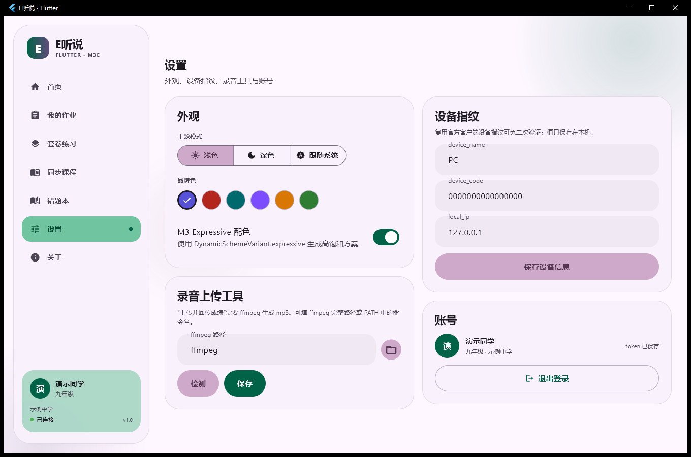
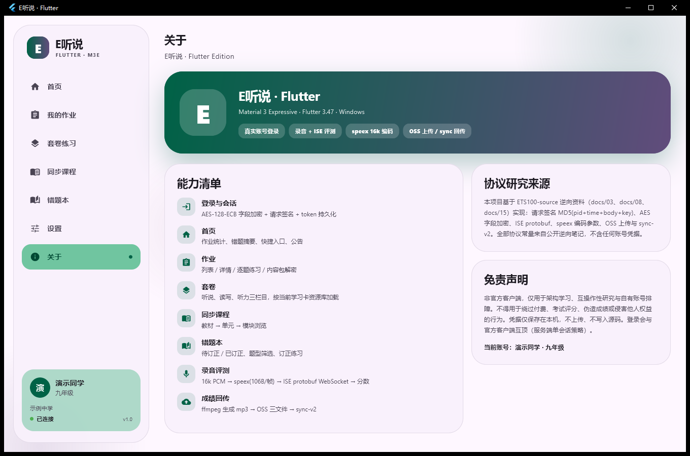

# E听说 · Flutter Edition

用 **Flutter 3 + Material 3 Expressive** 重写的「E听说」学生端 Windows 客户端。
不是套壳、不是网页嵌入：登录、作业、套卷、同步课程、错题本、口语录音、speex 编码、
即时评测（ISE WebSocket）、OSS 上传与成绩回传全部由 Dart / Native 代码实现。

> 非官方客户端，仅用于**互操作性研究、架构学习与自有账号排障**。
> 请使用你自己的账号，遵守服务条款；不要用于绕过付费、考试评分、伪造成绩或任何侵害他人权益的行为。


## 截图

| 作业列表 | 作业详情 | 口语练习 |
| --- | --- | --- |
|  |  |  |
| **套卷练习** | **同步课程** | **错题本** |
|  |  |  |
| **设置** | **关于** | |
|  |  | |

截图中的姓名、学校为演示占位（`ETS_DEMO=1`）。

## 功能

- **账号**：手机号 + 密码登录（AES-128-ECB 字段加密、请求签名、token 本地持久化），也支持直接粘贴已有 token。
- **首页**：作业统计、待订正、最近作业、公告、快捷入口。
- **作业**：待完成 / 已完成 / 已过期合并列表、详情、题目列表、逐题进入练习。
- **套卷**：按栏目（听说 / 读写 / 听力）浏览、搜索、按当前学习卡资源库加载。
- **同步课程**：教材 → 单元 → 模块三级浏览。
- **错题本**：待订正 / 已订正、听说/读写筛选、直接重练。
- **口语练习**：
  - content 包下载 → ZipCrypto 解密 → 解压 → `content.json` 解析；
  - 音频 / 图片资源播放与展示；
  - 麦克风采集 16 kHz 单声道 PCM → speex 编码（quality 10 / CBR 84800，106 B/帧）；
  - ISE WebSocket（protobuf over binary frames）即时评测，展示准确度 / 流利度 / 完整度 / 单词级分数；
  - ffmpeg 生成 mp3 → 阿里云 OSS（STS 临时凭据）三文件上传 → `/m/audio/sync-v2` 回传；
  - 作业最后一题自动触发完成逻辑（mistakeUpdate / setUseTime）。
- **外观**：M3 Expressive 配色、超大圆角、渐变 Blob 背景、弹性页面转场、录音波形；浅色/深色/跟随系统、6 种品牌色。

## 技术栈

| 层 | 实现 |
| --- | --- |
| UI | Flutter 3.47 / Material 3 + `DynamicSchemeVariant.expressive`；Manrope + Space Grotesk |
| 状态 | `provider` + `ChangeNotifier` |
| 网络 | `http`；请求体 `base64(JSON)`；响应 `[{msg,code,body}]` |
| 加密 | `pointycastle`（AES-128-ECB/PKCS7、MD5）；手写 ZipCrypto + raw DEFLATE |
| 录音 | `record`（PCM16LE 16 kHz mono） |
| 编码 | 自编译 `ets_speex.dll`（vendored Speex 1.2.1，FFI 调用） |
| 评测 | 手写 protobuf 编解码 + `WebSocket`（无 protobuf 依赖） |
| 存储 | `shared_preferences`、`path_provider` |
| 窗口 | `window_manager`（1360×900，最小 1120×720） |

## 快速开始

### 环境

- Windows 10/11 x64
- Flutter **3.47+**（Dart 3.13+）
- Visual Studio 2022/2026 Build Tools（含 C++ 桌面工作负载、Windows 10/11 SDK）

### 构建运行

```powershell
flutter pub get
flutter analyze
flutter build windows --release
.\build\windows\x64\runner\Release\ets_flutter.exe
```

首次启动进入登录页。登录后凭据仅保存在本机 `%APPDATA%`，不写入源码、不上传。

> 服务端是单会话：本客户端登录会把官方客户端顶下线，反之亦然。

### 重新编译 speex DLL（可选）

仓库已附带 `assets/native/ets_speex.dll`，通常无需重编。修改编码参数或升级 Speex 后：

```powershell
# 在 “Developer PowerShell for VS” 中执行
pwsh -File native/build.ps1
```

- 源码：`native/speex/`（vendored Speex 1.2.1，BSD-3-Clause）
- 封装：`native/ets_speex.cpp`
- 参数：16 kHz、单声道、quality 10、VBR off、bitrate 84800 → 106 B/帧
- 产物：`assets/native/ets_speex.dll`（应用启动时释放到临时目录并由 FFI 加载）

## 开发 / 自动化开关

通过环境变量控制，仅影响本机运行，不会写入仓库：

| 变量 | 作用 |
| --- | --- |
| `ETS_TOKEN` | 跳过登录，直接注入已有 token |
| `ETS_DEMO=1` | 截图模式：姓名/学校替换为演示占位 |
| `ETS_START_PAGE` | 启动页：`home` / `homework` / `sets` / `courses` / `mistakes` / `settings` / `about` |
| `ETS_START_HOMEWORK` | 启动后自动打开指定作业详情 |
| `ETS_START_PRACTICE=1` | 与上一项配合，直接进入第一题练习页（用于调试 content 包与评测） |

`Ctrl+1` … `Ctrl+7` 可在页面间快速切换。

## 测试

```powershell
# 静态检查
flutter analyze

# 离线测试（默认跳过真实网络用例）
flutter test

# 真实账号冒烟：API + ZipCrypto + speex + ISE
$env:ETS_LIVE_TEST='1'
$env:ETS_TOKEN='<token>'
$env:ETS_PCM='<pcm16k.raw>'
$env:ETS_SPX='<capture.spx>'
$env:ETS_CONTENT_URL='<content.zip>'
$env:ETS_ACCOUNT_ID='...'; $env:ETS_UID='...'
$env:ETS_CLASS_ID='...'; $env:ETS_SCHOOL_ID='...'
$env:ETS_GRADE_ID='...'; $env:ETS_STAGE_ID='...'
$env:ETS_REGION_ID='...'; $env:ETS_PAPER_ID='...'
flutter test test/live_smoke_test.dart
```

真实用例已验证：speex 生成 405 帧 / 42 930 B；content 包 4 个文件正确解出；
ISE 返回 `000000` 并解析出分数与单词明细。

## 目录结构

```text
lib/
  core/            # 常量、加密、API、ZipCrypto、内容包、speex FFI、ISE、录音、上传/回传
  ui/
    theme.dart     # M3 Expressive 主题与弹性转场
    widgets.dart   # HeroCard / Panel / SectionTitle / ScoreRing / RecordingWave 等
    pages/         # 登录、壳、首页、作业、套卷、课程、错题、练习、设置、关于
native/
  ets_speex.cpp    # speex 编码 DLL 封装
  speex/           # vendored Speex 1.2.1（BSD-3-Clause）
  build.ps1        # DLL 构建脚本
assets/
  fonts/           # Manrope / Space Grotesk
  native/          # ets_speex.dll
test/
  live_smoke_test.dart
docs/screenshots/
```

## 协议实现要点

与逆向笔记（见 [ETS100-source](https://github.com/hhz-or/ETS100-source) 的 `docs/`）一致：

- 请求体：`base64(JSON([{r, params}]))`；`head` 带 `version/sign/pid/time/time_second`。
- 签名：`MD5("pcWin" + time_ms + body_b64 + key)`。
- 登录字段：phone / password 经 AES-128-ECB/PKCS7 加密，并带设备指纹。
- content 包：zip 尾部 336 字节口令块派生 ZipCrypto 口令，解密后 raw DEFLATE 解压。
- ISE：`wss://…/ws/v2/ise`，init 帧（会话元数据 + JWT + 首块音频）→ 音频帧 → 结束帧 → 结果帧；
  XML 结果解析出总分、四维分与单词明细。
- 上传：STS 临时凭据 → OSS multipart（mp3/spx/xml）→ `sync-v2` 提交成绩与轨迹。

仓库不包含任何真实账号、token、设备码或抓包数据；协议字段来自公开逆向总结。

## 已知限制

- **Windows 桌面优先**：UI 针对桌面窗口设计；移动端尚未适配。
- 同步课程模块目前为浏览 + 计数，模块内套卷请在「套卷练习」中打开。
- 读写套卷中需要键盘/画布作答的题型未实现，仅覆盖听说类 content 包练习。
- 上传 mp3 依赖本机 ffmpeg；未安装时设置页会提示，可手动选择 `ffmpeg.exe`。
- 服务端单会话，token 失效会回到登录页；用官方客户端登录后需重新登录本客户端。
- 未实现自动更新、班级排行、PK、教师端等功能。

## 免责声明

本项目与讯飞 / E听说官方无任何关联，不提供任何官方资源或账号。
所有协议常量、算法与接口路径均来自对自有客户端与本机流量的研究，用于互操作性目的。
使用者需自行承担账号、数据与合规风险；作者不对因使用本项目产生的任何后果负责。
