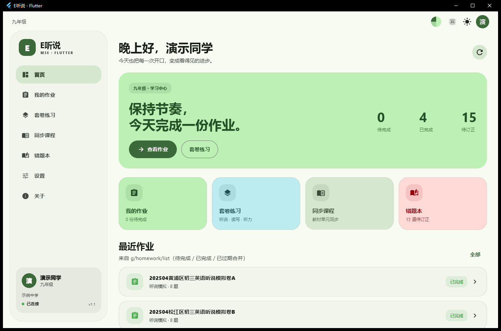
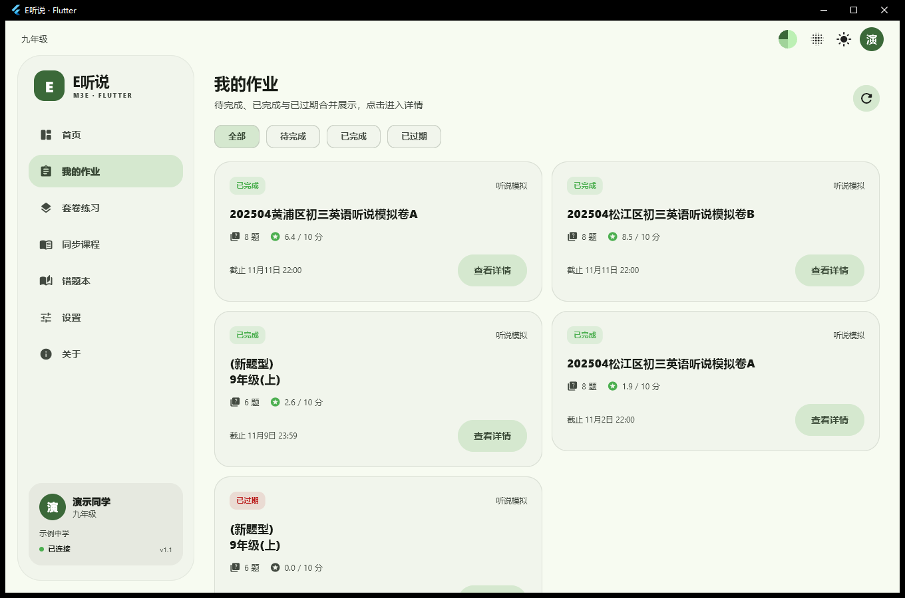
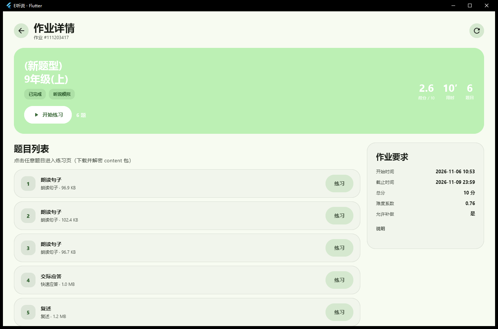
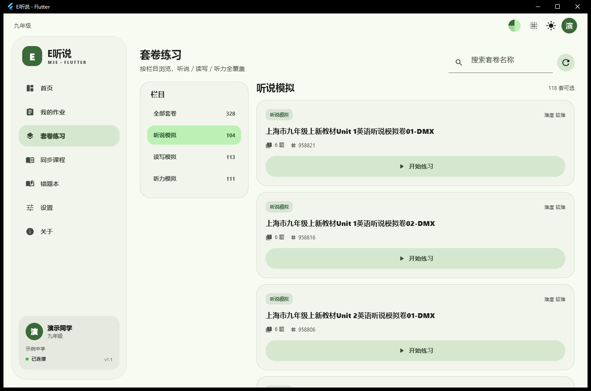
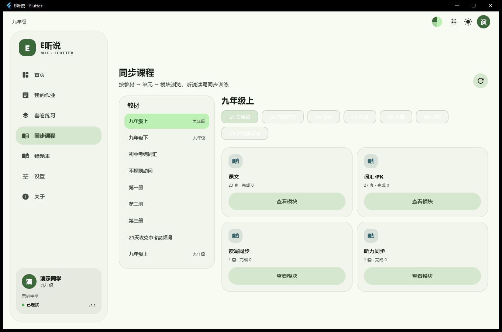
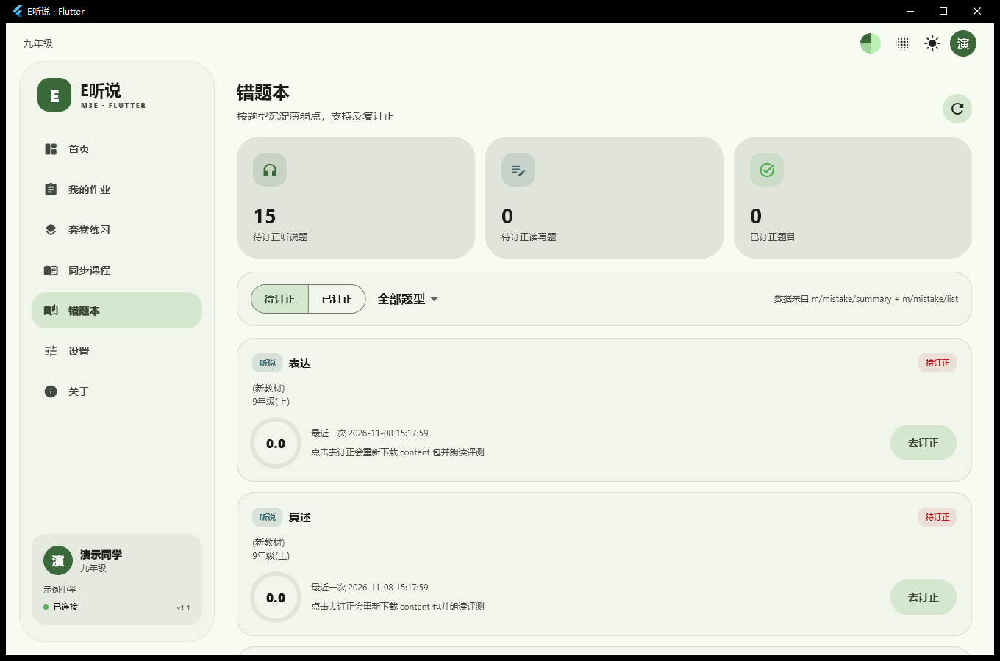
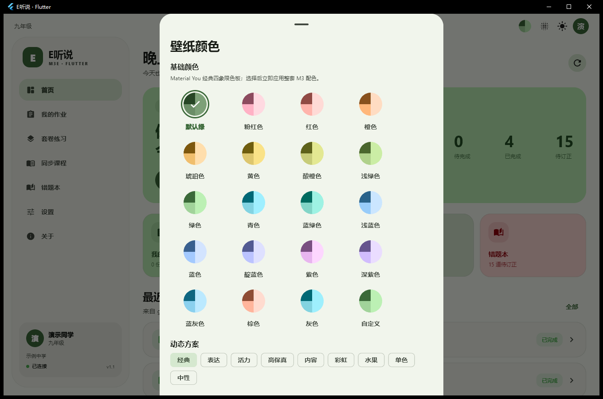
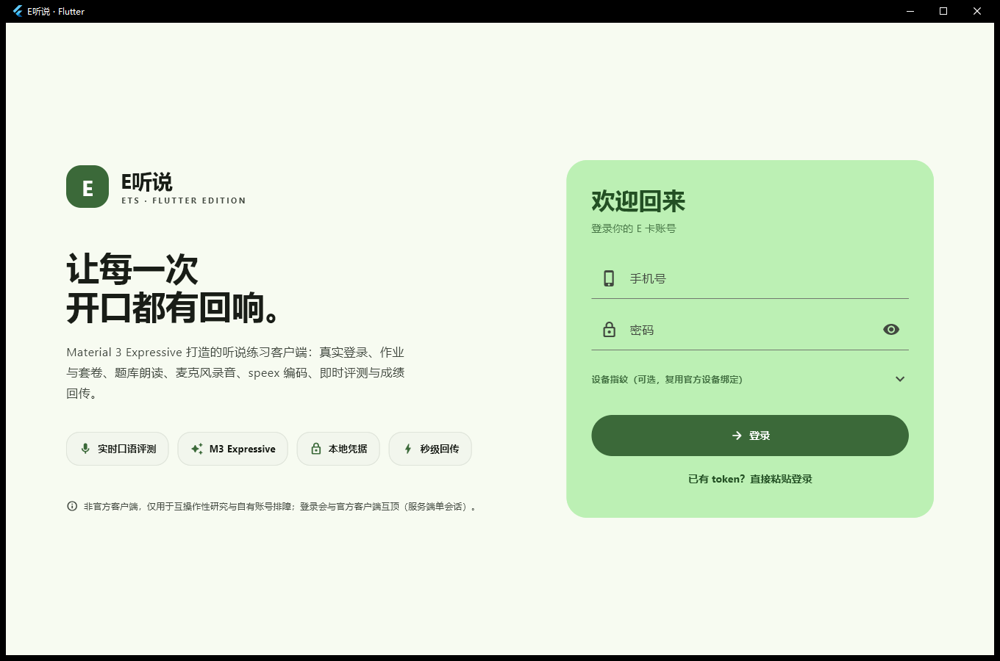
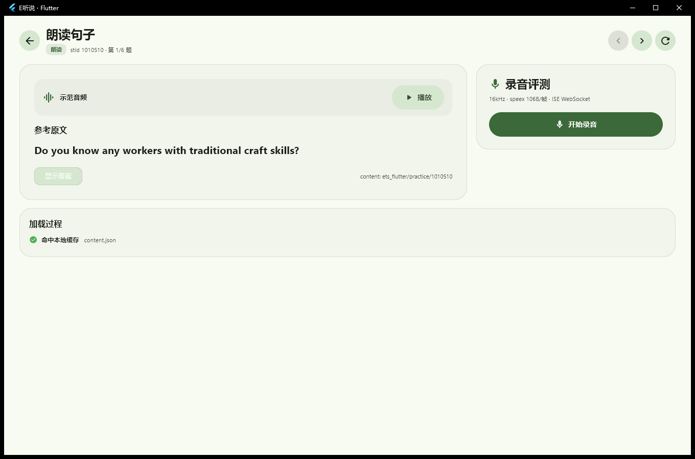

# E听说 · Flutter Edition

用 **Flutter 3.47 + Material 3 / Material 3 Expressive** 重写的「E听说」学生端客户端。
登录、作业、套卷、同步课程、错题本、口语录音、speex 编码、即时评测（ISE WebSocket）、
OSS 上传与成绩回传全部由 Dart / Native 代码实现。

> 非官方客户端，仅用于**互操作性研究、架构学习与自有账号排障**。
> 请使用自己的账号，遵守服务条款；不要用于绕过付费、考试评分、伪造成绩或侵害他人权益的行为。



## 截图

| 首页 | 作业列表 | 作业详情 |
| --- | --- | --- |
|  |  |  |
| **套卷练习** | **同步课程** | **错题本** |
|  |  |  |
| **壁纸颜色（Material You）** | **登录页** | **口语练习** |
|  |  |  |

截图中的姓名、学校为演示占位（`ETS_DEMO=1`）。

## 设计

- **严格 M3 token**：所有颜色来自 `ColorScheme.fromSeed`，`contrastLevel = 0`，不使用自造渐变、
  不使用高对比度/自合成三色；主色、容器色、表面色全部是 Material 3 角色。
- **Material You 壁纸颜色**：与 Android「壁纸与样式 → 基础颜色」一致的四象限圆形色板
  （默认绿 / 粉红 / 红 / 橙 / 琥珀 / 黄 / 酸橙 / 浅绿 / 绿 / 青 / 蓝绿 / 浅蓝 / 蓝 / 靛蓝 / 紫 / 深紫 / 蓝灰 / 棕 / 灰 / 自定义），
  另提供 `tonalSpot / expressive / vibrant / fidelity / content / rainbow / fruitSalad / monochrome / neutral` 动态方案。
- **M3E 组件**：使用 `material_ui`、`material_3_expressive`、`m3e_core`、`m3e_buttons` 的
  `M3ETextField`、`M3EButton`、`M3ESwitch`、`M3ESlider`、`M3EChip`、`M3ECard` 等组件与弹性动效。
- **Liquid Glass（可选）**：`liquid_glass_widgets` 只用于**导航 chrome**（侧栏、底部导航、部分弹出层），
  内容卡片保持 MD3 实色以保证可读性；开关和强度可在设置中调整。玻璃需要背景内容，平铺在实色内容上时
  会退化为半透明表面，这是有意为之。
- **全平台**：Windows / Android / iOS / Linux / macOS 工程已生成；Windows 已实机验证，
  Android/iOS 需本地 SDK，Linux/macOS 需对应工具链。Web 未包含（依赖本地文件与原生 speex/ffmpeg 链路）。

## 功能

- **账号**：手机号 + 密码登录（AES-128-ECB 字段加密、请求签名、token 本地持久化），也支持粘贴已有 token。
- **首页**：作业统计、待订正、最近作业、公告、快捷入口。
- **作业**：待完成 / 已完成 / 已过期合并列表、详情、题目列表、逐题进入练习。
- **套卷**：按栏目（听说 / 读写 / 听力）浏览、搜索。
- **同步课程**：教材 → 单元 → 模块浏览。
- **错题本**：待订正 / 已订正、听说/读写筛选、直接重练。
- **口语练习**：content 包下载 → ZipCrypto 解密 → 解压 → 解析；音频/图片展示；
  16 kHz PCM → speex（quality 10 / CBR 84800，106 B/帧）→ ISE protobuf WebSocket 评测 →
  ffmpeg mp3 → OSS STS 上传 → `/m/audio/sync-v2` 回传。
- **外观**：浅色 / 深色 / 跟随系统；Material You 壁纸颜色；Liquid Glass chrome 开关与强度。

## 平台与依赖

| 平台 | 状态 | 说明 |
| --- | --- | --- |
| Windows x64 | ✅ 实机验证 | 自带 `ets_speex.dll`，ffmpeg 从 PATH 或设置中选择 |
| Android | 🧱 工程已生成 | 需 Android SDK；`libets_speex.so` 需 NDK 编译放入 `jniLibs` |
| iOS | 🧱 工程已生成 | 需 Xcode；speex 需静态链接 |
| Linux | 🧱 工程已生成 | 用 `native/build.sh` 生成 `libets_speex.so` |
| macOS | 🧱 工程已生成 | 用 `native/build.sh` 生成 `libets_speex.dylib` |
| Web | ❌ 未包含 | 本地文件解密、FFI speex、ffmpeg 链路不适用 |

## 快速开始（Windows）

```powershell
flutter pub get
flutter analyze
flutter build windows --release
.\build\windows\x64\runner\Release\ets_flutter.exe
```

首次启动进入登录页；凭据只保存在本机 `%APPDATA%`，不写入源码。

> 服务端是单会话：本客户端登录会把官方客户端顶下线，反之亦然。

### 重新编译 speex

仓库已附带 Windows DLL；其它平台：

```bash
# Linux / macOS
bash native/build.sh

# Windows（Developer PowerShell for VS）
pwsh -File native/build.ps1
```

源码在 `native/speex/`（vendored Speex 1.2.1，BSD-3-Clause）。Android 需用 NDK 的
`aarch64-linux-android21-clang` 编译并放入 `android/app/src/main/jniLibs/arm64-v8a/`。

## 开发 / 自动化开关

| 变量 | 作用 |
| --- | --- |
| `ETS_TOKEN` | 跳过登录，注入已有 token |
| `ETS_CLEAR_AUTH=1` | 清除本地 token（用于调试登录页） |
| `ETS_DEMO=1` | 截图模式：姓名/学校替换为演示占位 |
| `ETS_START_PAGE` | 启动页：`home` / `homework` / `sets` / `courses` / `mistakes` / `settings` / `about` |
| `ETS_OPEN_PALETTE=1` | 启动后打开壁纸颜色面板 |
| `ETS_START_HOMEWORK` | 自动打开指定作业详情 |
| `ETS_START_PRACTICE=1` | 与上一项配合，直接进入第一题练习页 |
| `ETS_GLASS=1` / `ETS_GLASS_STRENGTH` | 强制开启玻璃 / 设置强度 |

`Ctrl+1` … `Ctrl+7` 切换页面。

## 测试

```powershell
flutter analyze          # 仅剩 info 级 lint
flutter test             # 离线单测（真实网络用例默认 skip）
```

真实冒烟（需自行注入环境变量，见 `test/live_smoke_test.dart`）覆盖 API、ZipCrypto、speex 编码与 ISE 回放。

## 目录结构

```text
lib/
  core/            # 常量、加密、API、ZipCrypto、内容包、speex FFI、ISE、录音、上传/回传
  ui/
    theme.dart     # 严格 M3 token、字体与转场
    palette_picker.dart # Material You 四象限色板
    glass.dart     # 可选 Liquid Glass chrome
    widgets.dart   # BrandMark / Panel / SectionTitle / ScoreRing 等
    pages/         # 登录、壳、首页、作业、套卷、课程、错题、练习、设置、关于
native/            # speex 封装、vendored speex、构建脚本
assets/            # 字体、Windows speex DLL
android/ ios/ linux/ macos/ windows/
test/
docs/screenshots/
```

## 协议实现要点

与逆向笔记（见 [ETS100-source](https://github.com/hhz-or/ETS100-source) 的 `docs/`）一致：

- 请求体：`base64(JSON([{r, params}]))`；`head` 带 `version/sign/pid/time/time_second`。
- 签名：`MD5("pcWin" + time_ms + body_b64 + key)`。
- 登录字段 AES-128-ECB/PKCS7 加密，并带设备指纹。
- content 包：zip 尾部 336 字节口令块派生 ZipCrypto 口令，解密后 raw DEFLATE 解压。
- ISE：会话元数据 + JWT + 音频帧 + 结束帧 → XML 结果解析。
- 上传：STS → OSS multipart（mp3/spx/xml）→ `sync-v2`。

仓库不包含任何真实账号、token、设备码或抓包数据。

## 已知限制

- 移动端 UI 已做基础响应式（底部导航、单列练习/设置），但未在真机验证；Android 无 SDK 环境。
- 非 Windows 平台需自行编译 speex 动态库；移动端也未内置 ffmpeg，成绩回传仅桌面端开放。
- 同步课程模块为浏览 + 计数；读写套卷中需键盘/画布的题型未实现。
- Liquid Glass 仅覆盖导航 chrome；内容卡片按 MD3 规范保持实色。
- 服务端单会话，token 失效会回到登录页。

## 免责声明

本项目与讯飞 / E听说官方无任何关联，不提供任何官方资源或账号。
所有协议常量、算法与接口路径均来自对自有客户端与本机流量的研究，用于互操作性目的。
使用者需自行承担账号、数据与合规风险；作者不对因使用本项目产生的任何后果负责。
